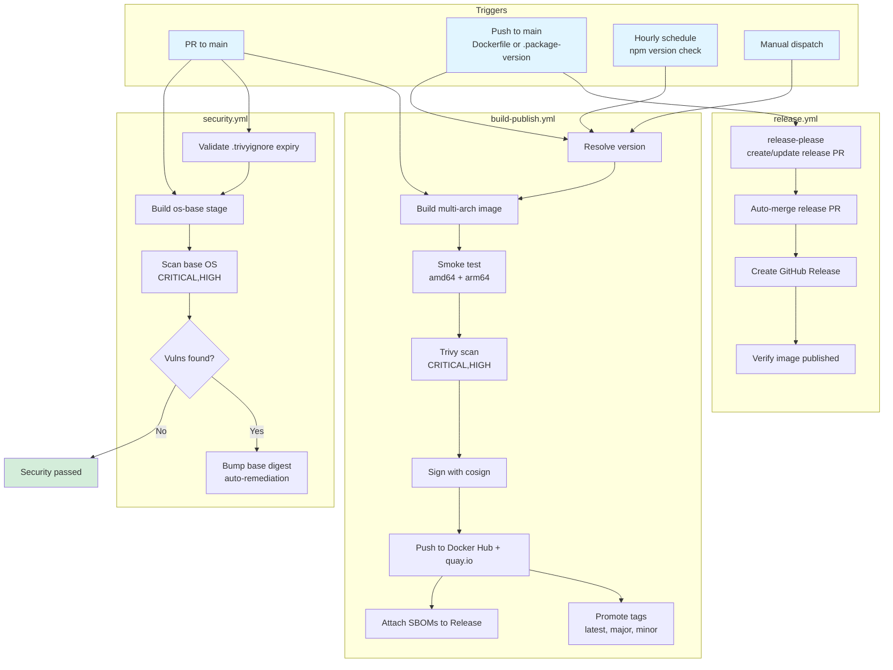
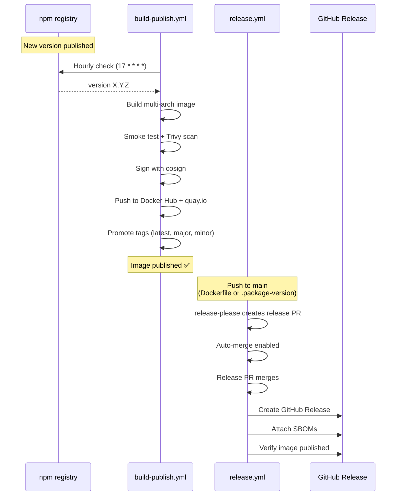

# GitHub Workflows

This directory contains the CI/CD workflows for the SquadRules MCP container packaging pipeline.

## Flow Overview

## Trigger Matrix

| Workflow | PR to main | Push to main | Schedule | Manual |
|----------|-----------|--------------|----------|--------|
| **build-publish.yml** | ✅ Always | ✅ Dockerfile, .trivyignore, .package-version, .release-please-manifest.json, CHANGELOG.md | ✅ Hourly (17 * * * *) | ✅ |
| **security.yml** | ✅ Always | ✅ Always | ✅ Daily (0 2 * * *) | ✅ |
| **release.yml** | ❌ | ✅ Dockerfile, .package-version | ❌ | ✅ |

## Pipeline Stages

### 1. Build & Publish (`build-publish.yml`)

**Purpose**: Build, test, scan, sign, and publish the container image.

**Jobs**:
1. **resolve** — Determines target version (npm latest or manual input), computes fingerprint
2. **build** — Multi-arch build (amd64 + arm64), smoke tests, Trivy scan
3. **publish** — Sign with cosign, push to Docker Hub + quay.io, promote channel tags, attach SBOMs

**Key features**:
- Fingerprint-based skip: skips if `sha256(Dockerfile + PACKAGE_VERSION)[:12]` already published
- Multi-arch smoke tests: full HTTP boot on amd64, native module check on arm64 (QEMU)
- Idempotent publish: checks both registries before building

### 2. Security Governance (`security.yml`)

**Purpose**: Validate ignore file metadata and shift-left on base OS vulnerabilities.

**Jobs**:
1. **trivyignore-expiry** — Fails CI for expired/invalid `.trivyignore` entries, warns within 45 days
2. **container-base-os-trivy** — Builds `os-base` stage, scans for CRITICAL/HIGH OS vulns
3. **auto-remediation** — On failure, bumps base digest in Dockerfile, opens auto-merge PR

**Key features**:
- Does NOT scan npm libraries (that's build-publish.yml's job)
- Machine-owned base digest: security.yml bumps it when Trivy finds vulns
- Separate from the authoritative full-image scan in build-publish.yml

### 3. Release Management (`release.yml`)

**Purpose**: Create GitHub Releases and verify published images.

**Jobs**:
1. **release-please** — Creates/updates release PR based on conventional commits
2. **auto-merge-release-pr** — Enables auto-merge on release PRs
3. **publish** — Verifies image exists in both registries, attaches SBOMs to GitHub Release

**Key features**:
- Only triggers on image-affecting changes (Dockerfile, .package-version)
- Release PRs auto-merge once checks pass
- Publish job verifies both fingerprint and version tags exist

## Release Flow

## Version Tracking

| File | Purpose | Updated by |
|------|---------|-----------|
| `mcp/Dockerfile` | Image definition (base digest, stages, build args) | security.yml (base digest), manual (stages) |
| `.package-version` | Current @squadrules/mcp npm version | build-publish.yml (when publishing) |
| `.release-please-manifest.json` | Last released version | release-please |
| `CHANGELOG.md` | Release notes | release-please |

## Conventions

- **Pipeline contracts** are encoded as header comments in workflow YAML, Dockerfile, and scripts
- **Gate authority**: build-publish.yml owns the authoritative scan; security.yml owns only base-OS shift-left
- **Scratch artifacts**: `.local/` and `.cache/` are gitignored pipeline scratch
- **Documentation coupling**: stage names, triggers, tag channels must match across all files
